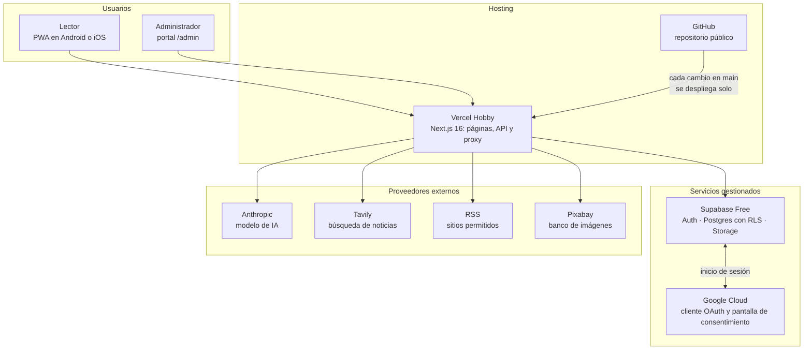

# Infraestructura

Qué servicios componen el sistema, quién hace qué y cuánto cuesta cada uno. Es la
vista corta: para operar cada pieza, ver [INFRA_HANDOFF.md](INFRA_HANDOFF.md).

## Vista por capas

Las personas solo hablan con Vercel. La app es la única que habla con los demás
servicios, siempre desde el servidor: ninguna llave de un proveedor externo llega al
navegador.

## Qué hace cada pieza

| Servicio | Para qué | Plan y costo | Variable de entorno |
|---|---|---|---|
| **GitHub** | Guarda el código. Un cambio que llega a `main` dispara el despliegue | Gratis | — |
| **Vercel** | Aloja la app y la publica en <https://respia-news.vercel.app> | Hobby, gratis. Uso no comercial y un solo desarrollador | — |
| **Supabase** | Inicio de sesión, base de datos con RLS y almacenamiento de las imágenes que sube el administrador | Free, gratis. Se pausa tras 7 días sin actividad de la base | `NEXT_PUBLIC_SUPABASE_URL`, `NEXT_PUBLIC_SUPABASE_PUBLISHABLE_KEY` (ambas públicas por diseño) |
| **Google Cloud** | Contiene el cliente OAuth con el que Google autentica a cada persona. Supabase le pide el inicio de sesión; la app nunca habla directo con Google | Gratis. No pide cuenta de facturación | Sus dos credenciales viven solo en Supabase, no en la app |
| **Anthropic** | El modelo que redacta las respuestas del chat y propone la imagen de una noticia | Pago por uso, de los USD 20 de créditos. Tope de USD 14 hasta la demo | `ANTHROPIC_API_KEY` |
| **Tavily** | Busca noticias externas cuando la app no tiene ninguna sobre la pregunta | Plan gratuito de 1 000 créditos al mes; cada búsqueda gasta uno | `TAVILY_API_KEY` |
| **RSS** | Primera búsqueda externa, antes de gastar un crédito de Tavily | Gratis | — |
| **Pixabay** | Candidatas de imagen para una noticia sin foto | API con llave, sin costo para el equipo | `PIXABAY_API_KEY` |

El costo de la infraestructura es **cero**: los USD 20 son solo para los créditos de
IA. Los nombres de las variables salen de `.env.example`; los valores no se guardan
en el repositorio, que es público.

## Lo que no se debe romper

- **El proyecto de Google Cloud y su cliente OAuth no se apagan ni se borran.** Si
  eso pasa, nadie puede iniciar sesión de nuevo. Restaurarlo puede tardar días.
- **La pantalla de consentimiento solo pide los permisos básicos** (nombre, correo y
  perfil). Con otro permiso, el modo de prueba de Google empezaría a limitar quién
  entra.
- **Supabase se pausa por inactividad.** Antes de una demostración hay que confirmar
  en su panel que el proyecto está activo.
- **Los secretos (llave de Anthropic, Tavily y Pixabay) viven solo en las variables
  de entorno de Vercel y en el `.env.local` de cada persona.** Nunca en el repositorio.

Más detalle de cada punto, con los pasos para recuperarlo, en
[INFRA_HANDOFF.md](INFRA_HANDOFF.md) (secciones 6, 14 y 15).
